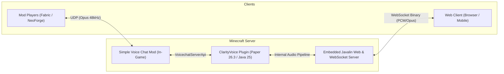

# ClarityVoice

[](https://papermc.io)
[](https://www.oracle.com/java/)
[](https://gradle.org)
[](https://modrinth.com/plugin/simple-voice-chat)
[](LICENSE)

**ClarityVoice** is a modern, high-performance **Web & Mod Proximity Voice Chat Bridge** custom-engineered for **Clarity Network** (Minecraft 1.21.4+ / Paper 26.3+ / Java 25). It bridges players using the in-game **Simple Voice Chat** mod with players connecting directly through any modern web browser via **WebSockets** and **Web Audio API (HRTF 3D Spatial Audio)**, requiring zero client mods or resource packs.

---

## Table of Contents

- [Features](#features)
- [Architecture and Audio Flow](#architecture-and-audio-flow)
- [Voice Group Integration](#voice-group-integration)
- [Supported Languages](#supported-languages)
- [Commands and Permissions](#commands-and-permissions)
- [Configuration](#configuration)
- [Web Interface and Controls](#web-interface-and-controls)
- [Directory Structure](#directory-structure)
- [Building from Source](#building-from-source)
- [License](#license)

---

## Features

- **Zero-Mod Web Client**: Players without Fabric, Forge, or NeoForge can participate in voice chat simply by opening a link in their browser (Chrome, Edge, Firefox, Safari) on Desktop, Tablet, or Mobile.
- **3D Spatial HRTF Audio**: Web clients hear nearby players in 3D spatial sound. Volume and stereo panning dynamically adjust in real time according to the player's in-game distance, position, yaw, and pitch.
- **Full Voice Group Integration**: Seamless cross-play voice groups. Web players hear group members across any distance in centered stereo (`0x03` packet) and can transmit back to in-game mod group members.
- **In-Game Speaker Icon Synchronization**: Web-connected players have their Simple Voice Chat speaker icon enabled in-game (`VoicechatConnection.setConnected(true)`), so other players know they are listening and speaking. Mute and deafen status synchronizes automatically.
- **Hardware Audio Device Selection**: Built-in dropdown selectors on the web interface allow players to switch their physical microphone input and speaker/headphone output on the fly.
- **Modern Aqua and Ice Cyan Theme**: Custom visual interface styled with Clarity Network's signature aesthetic, interactive VU meter, 3D radar grid, and official branding.
- **Multi-Language Support (9 Languages)**: Includes complete in-game and web UI translations for Indonesian, English, German, Spanish, French, Japanese, Portuguese, Russian, and Chinese. Fully integrated with ClarityLangCore.
- **Secure OTP Authentication**: Single-use, time-limited 6-digit OTP tokens generated via `/voice otp`. Prevents session hijacking and spoofing with automatic single-active-session enforcement.
- **Embedded Javalin Web and WebSocket Engine**: Ultra-fast static asset serving and low-latency binary audio streaming (`/ws/voice`) running asynchronously on a dedicated thread pool without impacting Minecraft server TPS.
- **48kHz Opus Voice Streaming**: 16-bit 48kHz audio encoding and decoding using native Opus codec channels for maximum voice clarity and minimal network bandwidth.

---

## Architecture and Audio Flow



### 1. In-Game Mod to Web Client Audio Flow
1. In-game player speaks into their microphone via Simple Voice Chat mod.
2. `ClarityVoiceChatPlugin` intercepts audio packets via `MicrophonePacketEvent`.
3. Server decodes Opus frames into 16-bit 48kHz PCM short arrays using `OpusDecoder`.
4. Recipients are categorized:
   - **Group Members**: Sent non-positional stereo audio (`0x03` Group Audio Packet) with zero distance rolloff.
   - **Proximity Listeners**: Sent 3D positional audio (`0x01` Proximity Audio Packet) including sender's X, Y, Z coordinates.
5. Web Audio API processes incoming frames through `PannerNode` (HRTF) or direct `GainNode` for instant playback.

### 2. Web Client to In-Game Mod Audio Flow
1. Web client captures microphone audio via `AudioWorklet` / `MediaStream`.
2. Audio frames (960 samples, 20ms) are gated via VAD (Voice Activity Detection) or PTT (Push-to-Talk) and transmitted over WebSocket (`0x02` Mic Packet).
3. `WebVoiceServer` receives PCM audio and passes it to `WebEntityAudioSender`.
4. Server encodes PCM to Opus and delivers it in-game via `EntityAudioChannel` (for proximity listeners) and `StaticAudioChannel` (for group members).

---

## Voice Group Integration

ClarityVoice integrates directly with Simple Voice Chat's group system:

| Feature | Mod Player | Web Player |
| :--- | :---: | :---: |
| **Hear Proximity Players** | Yes | Yes (3D HRTF) |
| **Hear Group Members Globally** | Yes | Yes (Stereo Direct) |
| **Speak to Group Members** | Yes | Yes (`StaticAudioChannel`) |
| **Voice Group HUD Card** | In-Game GUI | Web Dashboard (`#voiceGroupCard`) |
| **In-Game Speaker Icon** | Mod Icon | Connected Icon (`conn.setConnected(true)`) |

---

## Supported Languages

ClarityVoice supports 9 production-ready languages out-of-the-box, both in-game and on the web:

| Language | Code | Web UI | In-Game (ClarityLangCore) |
| :--- | :---: | :---: | :---: |
| **Bahasa Indonesia** (Default) | `id_ID` | Yes | Yes |
| **English (US)** | `en_US` | Yes | Yes |
| **Deutsch** | `de_DE` | Yes | Yes |
| **Español** | `es_ES` | Yes | Yes |
| **Français** | `fr_FR` | Yes | Yes |
| **日本語** | `ja_JP` | Yes | Yes |
| **Português (Brasil)** | `pt_BR` | Yes | Yes |
| **Русский** | `ru_RU` | Yes | Yes |
| **简体中文** | `zh_CN` | Yes | Yes |

*If ClarityLangCore is present, in-game messages automatically inherit the player's personal language preference. Otherwise, clean native fallback messages are displayed.*

---

## Commands and Permissions

| Command | Aliases | Description | Permission | Default |
| :--- | :--- | :--- | :--- | :---: |
| `/voice otp` | `/cv otp`, `/clarityvoice otp` | Generates a 6-digit OTP code to login on the web client | `clarityvoice.use` | Everyone (`true`) |
| `/voice disconnect` | `/cv dc` | Disconnects your active web voice session | `clarityvoice.use` | Everyone (`true`) |
| `/voice status` | `/cv status` | Shows current Mod, Web, and Group voice connection status | `clarityvoice.use` | Everyone (`true`) |
| `/voice help` | `/cv help` | Displays list of voice commands | `clarityvoice.use` | Everyone (`true`) |

---

## Configuration

```yaml
# ==============================================================================
#                       ClarityVoice Configuration
#   Cross-platform 3D Proximity Voice Chat (Simple Voice Chat Mod <-> Web App)
# ==============================================================================

server:
  # IP address / host to bind the embedded Javalin Web & WebSocket server.
  # Use "0.0.0.0" to listen on all interfaces.
  host: "0.0.0.0"

  # Port for both Web Client HTTP static files and WebSocket (/ws/voice).
  port: 12024

  # Public URL accessible by players in browser.
  # Used for the clickable chat link when players run "/voice otp".
  public_url: "https://voice.clarity-id.net"

voice:
  # Maximum hearing distance in Minecraft blocks.
  max_distance: 48.0

  # OTP code validity duration in seconds (default: 120 seconds = 2 minutes).
  otp_duration_seconds: 120

  # Interval in ticks for syncing 3D player positions and orientations to Web clients.
  # 20 ticks = 1 second. 2 ticks = 100ms.
  position_sync_interval_ticks: 2

  # Category name for Simple Voice Chat volume settings in mod menu.
  category_name: "clarity_voice"
```

---

## Web Interface and Controls

### 1. Connecting via OTP
- Players run `/voice otp` in Minecraft.
- Click `[BUKA WEB VOICE]` or open the server's voice web address.
- Enter the 6-digit code or paste it with `Ctrl+V`.
- Browser requests microphone permission: click **Allow**.
- *HTTP Fallback*: If running over plain HTTP without SSL, browser switches gracefully to **Listen-Only Mode** so players can still hear everyone in 3D.

### 2. Audio Controls
- **Voice Activity Detection (VAD)**: Real-time logarithmic VU meter with adjustable sensitivity slider.
- **Push-to-Talk (PTT)**: Hold on-screen button, press `[Space]`, or press `[V]`.
- **Mute and Deafen**: One-click toggling with instant synchronization to in-game Simple Voice Chat indicators.
- **Device Selectors**: Change microphone input and speaker output directly from the dashboard.
- **Per-Player Volume**: Adjust individual player volumes or master volume independently.

---

## Directory Structure

```text
ClarityVoice/
├── build.gradle.kts                        # Gradle build configuration
├── settings.gradle.kts                     # Gradle settings
├── LICENSE                                 # GNU General Public License v3.0
├── src/main/
│   ├── java/me/harukiyu/clarityvoice/
│   │   ├── ClarityVoice.java               # Main JavaPlugin lifecycle
│   │   ├── audio/
│   │   │   ├── AudioPayloadHelper.java     # Binary protocol serializer (0x01, 0x02, 0x03)
│   │   │   └── WebEntityAudioSender.java   # Audio transmitter to SVC channels
│   │   ├── command/
│   │   │   └── VoiceCommand.java           # In-game /voice command handler
│   │   ├── config/
│   │   │   └── VoiceConfig.java            # Configuration loader
│   │   ├── listeners/
│   │   │   └── PlayerListener.java         # Join, quit, and world change handler
│   │   ├── model/                          # Data models (CachedPlayerLocation, OtpEntry)
│   │   ├── service/
│   │   │   ├── OtpManager.java             # OTP generation and expiration
│   │   │   ├── PositionCache.java          # Thread-safe player location cache
│   │   │   ├── PositionSyncTask.java       # Periodic 3D position & group sync task
│   │   │   ├── SessionManager.java         # WebSocket session & SVC connection lifecycle
│   │   │   └── TranslationService.java     # ClarityLangCore & MiniMessage provider
│   │   ├── voice/
│   │   │   └── ClarityVoiceChatPlugin.java # Simple Voice Chat API implementation
│   │   └── web/
│   │       ├── WebVoiceServer.java         # Embedded Javalin HTTP & WS engine
│   │       └── WebVoiceSession.java        # Authenticated client representation
│   └── resources/
│       ├── plugin.yml                      # Paper plugin metadata
│       ├── config.yml                      # Default configuration
│       ├── languages/                      # 9 Language YAML bundles
│       └── web/
│           ├── index.html                  # Responsive Web Client UI
│           ├── style.css                   # Aqua Blue & Ice Cyan Design System
│           ├── app.js                      # Web Audio API & WebSocket Client Engine
│           └── clarity-logo.png            # Clarity Network Official Logo
```

---

## Building from Source

### Prerequisites
- **Java 25** (JDK 25.0.3+ recommended)
- **Gradle 9.5+** (or use included `./gradlew`)

### Build Command
```bash
# Clean and compile shadowed JAR
./gradlew clean shadowJar
```

The resulting plugin JAR will be located at:
```text
build/libs/ClarityVoice-1.0.0-SNAPSHOT.jar
```

---

## License

This project is licensed under the terms of the [GNU General Public License v3.0](LICENSE).
